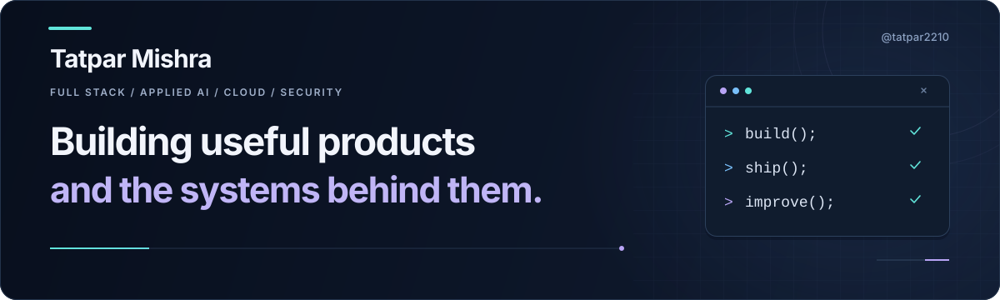

  

  <strong>Senior Full Stack Engineer · Product Builder · Applied AI</strong> 
  Pune, India · 3+ years building and supporting production applications

  
  &nbsp;
  
  &nbsp;
  

  <a href="#about-me">About</a> ·
  <a href="#selected-work">Projects</a> ·
  <a href="#engineering-impact">Impact</a> ·
  <a href="#technical-toolkit">Toolkit</a> ·
  <a href="#career-journey">Journey</a>

---

## About me

Hey, I'm **Tatpar** 👋

I build enterprise applications, commerce platforms and AI-powered products. My work connects the interface, APIs, data pipelines and deployment process, and continues through production support and improvement.

I'm currently a **Senior Software Engineer at ZS Associates, through NetConnect Global**, working on enterprise systems, reusable application architecture, code reviews and security remediation. I'm also building **[StudentCurio](https://studentcurio.com)**, a learning platform focused on JEE and CBSE preparation.

I enjoy turning complicated workflows into clear interfaces, making slow systems faster, and tracing recurring production problems back to their cause. The interesting part is understanding how all the pieces fit together.

### The work I gravitate toward

- **Useful products:** enterprise workflows, commerce experiences and tools that make learning easier.
- **Thoughtful backend design:** clear API contracts, reusable services and configuration-driven workflows.
- **Practical AI:** recommendations, product discovery, forecasting and document-based learning tools.
- **Production ownership:** security fixes, automated delivery, observability and incident investigation.

## Selected work

### 📚 StudentCurio

**Making study resources and practice easier to navigate.**

I'm building a platform for JEE and CBSE learners, with a focus on chapter-wise resources, previous-year questions and practice workflows. It brings together my interests in product development, education and applied AI.

My engineering focus includes React interfaces, FastAPI services, resource organization, assessment experiences and public content discovery. I'm also exploring self-hosted retrieval-augmented generation (RAG) and document-to-question workflows as part of its future development.

**Core technologies:** React · Python · FastAPI  
**Explore:** [studentcurio.com →](https://studentcurio.com)

### 🛍️ Discoverist.ai Shopify app

**Helping merchants make product discovery more relevant.**

Built the recommendation-engine backend and integrated the Shopify Admin API for an AI-powered product discovery app. The project reached approximately **560 merchant installs**.

This work brought together recommendation logic, platform integration and the practical requirements of a merchant-facing product.

**Focus:** AI recommendations · Shopify integration · Backend development  
**Explore:** [Shopify App Store →](https://apps.shopify.com/discoverist)

<strong>More projects — machine learning, forecasting and automation</strong>

| Project | What I built |
| :--- | :--- |
| [Employee Turnover Analytics](https://github.com/tatpar2210/Employee-Turnover-Analytics) | An employee attrition prediction pipeline using Python, Pandas and Random Forest, achieving **85% accuracy on the project's test set**. |
| [Retail Demand Forecasting](https://github.com/tatpar2210/Walmart-Retail-Analysis) | Retail sales forecasting with Prophet and ARIMA, analysing weekly demand and seasonality; **12% MAPE on held-out sales data**. |
| [Marketing Tool](https://github.com/tatpar2210/Marketing-Tool) | A Python command-line application combining inventory management, barcode simulation and CSV reporting. |

## Engineering impact

A few outcomes from projects I've worked on:

| Area | Result | Context |
| :--- | :--- | :--- |
| Application security | **1,129 reported flaws remediated** | Used Veracode to identify and resolve application findings at ZS Associates. |
| API performance | **950 ms → 630 ms** | Improved API response times over three months at ZS Associates. |
| Maintainability | **100 modules → 44** | Refactored legacy frontend and backend code into reusable components over six months. |
| Build performance | **45 min → 15–20 min** | Optimised build and bundling configurations for an enterprise React application. |
| AI recommendations | **p95 < 500 ms · +10% click-through** | Built recommendation APIs at E.Soft; click-through improved over six months. |

At ZS, I also led code reviews and system-design discussions for a **seven-engineer team**, contributing to a **25% reduction in post-release defects over eight months**.

## Technical toolkit

| Area | Technologies and tools |
| :--- | :--- |
| **Languages** | Python · TypeScript · JavaScript · SQL |
| **Frontend** | React · Next.js · Tailwind CSS · Angular · Ionic |
| **Backend and APIs** | FastAPI · Pydantic · Node.js · Express.js · REST · GraphQL |
| **Databases** | PostgreSQL · MySQL · MongoDB · BigQuery |
| **Data and applied ML** | Kafka · Spark · Pandas · Random Forest · Prophet · ARIMA |
| **Cloud and delivery** | AWS · Docker · Linux · Git · GitLab CI/CD |
| **Quality and security** | pytest · Jest · Cypress · Veracode · Unit, integration and API testing |
| **Automation** | Python scripting · Codex · AI-assisted development · Workflow automation |

<strong>AWS services I've worked with</strong>

Amazon EC2 · Amazon S3 · AWS Lambda · AWS Secrets Manager · Amazon CloudWatch

## Career journey

| When | Role | Where |
| :--- | :--- | :--- |
| **Dec 2025 – Present** | Senior Software Engineer | **ZS Associates**, through NetConnect Global |
| **Feb 2025 – Nov 2025** | Senior Consultant — Development | **E.Soft** |
| **Feb 2024 – Oct 2024** | Software Developer Engineer II | **Carnera Technologies Inc.** |
| **Jan 2023 – Feb 2024** | Shopify Developer | **Techsurvi** |

<strong>What I worked on at each company</strong>

### ZS Associates

Enterprise React, TypeScript, Node.js and FastAPI applications; configuration-driven business workflows with Pydantic; secure API integrations; code reviews; and AWS deployments using Docker and GitLab CI/CD. My work spans application architecture, vulnerability remediation, production incident investigation and stakeholder validation.

### E.Soft

Next.js interfaces and Python/FastAPI and Node.js APIs for a social-commerce platform supporting **25 active brands and approximately 5,000 orders per month**. Worked across brand onboarding, orders, promotions, gift vouchers, administrative tools and AI recommendations, alongside production support and root-cause analysis.

### Carnera Technologies Inc.

Enterprise Node.js and React applications with FastAPI integrations, plus Kafka and Spark pipelines for data processing. Worked on batch processing, caching, partitioning, Docker deployments, automated tests, logging and error handling.

### Techsurvi

Shopify SaaS features, multi-tenant ETL workflows and PostgreSQL analytics pipelines. Worked with React, Node.js and Python, improved AWS infrastructure and delivery workflows, and added Jest/Cypress tests, CloudWatch alerts and troubleshooting runbooks.

<strong>Where it started — internships and education</strong>

**GlobalBees Brands Pvt Ltd · Technical Intern · Feb 2022 – Jan 2023**  
Built e-commerce interfaces using React and Node.js, and developed REST APIs with MongoDB document models.

**UG Life style Pvt. Ltd. · Technical Intern · Sep 2021 – Feb 2022**  
Automated deployment workflows and API monitoring with AWS Lambda, and improved JavaScript application features.

**B.Tech in Computer Science · Bharati Vidyapeeth Deemed University, Pune · 2025**

**Data Scientist Masters Program · Simplilearn · Completed July 2025**  
[View credential →](https://success.simplilearn.com/5c8982ee-3cec-41ae-9167-f7a51bd5aaf7)

## How I approach the work

- **Understand the workflow.** Start with what the user needs to accomplish and make the technical choices serve that goal.
- **Make contracts clear.** Define predictable API behavior, validate inputs and keep responsibilities understandable.
- **Build for the next change.** Prefer reusable components and configuration where they make future work simpler.
- **Follow through after release.** Use tests, logs, security checks and production feedback to improve the system.
- **Measure the result.** Connect engineering changes to latency, reliability, delivery time or the user's experience.

## Let's connect

Interested in my work? You can reach me through **[LinkedIn](https://www.linkedin.com/in/tatpar-mishra-267aa0208/)** or **[email](mailto:2210tatpar@gmail.com)**.

If you're exploring my projects, start with **[StudentCurio](https://studentcurio.com)**, **[Discoverist](https://apps.shopify.com/discoverist)** or **[my repositories](https://github.com/tatpar2210?tab=repositories)**.

---

  Built with curiosity. Improved through real-world use.

